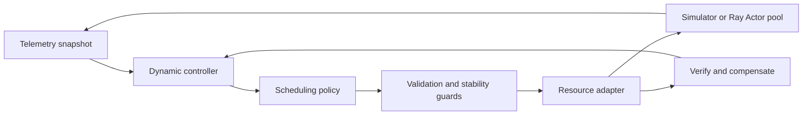

# Architecture and scope

`models.py` defines capacity, workload, allocation, snapshot, plan and adapter contracts.
`policies.py` provides three deterministic planners. `controller.py` separates periodic
replanning from resource execution and implements stability guards and compensation.
`simulator.py` owns explicit stage queues and a seeded event loop with safe draining.
`adapters.py` provides an idempotent in-memory adapter and the safe-point signal.
`ray_adapter.py` optionally manages real CPU/memory Actors for trusted synthetic tasks.
`scenarios.py`, `cli.py` and `benchmarks.py` supply reproducible profiles, traces and comparisons.

**ADR-001: Simulator first.** The default package runs without Ray or GPUs. Demand
profiles and synthetic costs are explicit assumptions, not measurements of real RL.

**ADR-002: Optional Ray.** Integration uses public Actor APIs against pinned Ray 2.50.1.
Ray owns worker processes; this project owns only its registered pool. Resource
reservations are logical. Arbitrary or untrusted code execution is not offered.

**ADR-003: Drain before disruptive change.** Simulated GPU reallocation waits for
in-flight stages to drain; the Ray adapter rejects all GPU changes. Real training
gang safe-point coordination must be implemented by a future runtime adapter.

**ADR-004: In-memory controller.** Input snapshots and operation generations are
journaled in memory. Apply failures compensate to the previous allocation; failed
compensation blocks writes. Durable recovery, multi-driver control and leader
election remain outside this slice.

See [control loop](control-loop.md), [Ray integration](ray-sandbox.md) and
[benchmark methodology](benchmarks.md).

## Local runtime modules

`sandbox.py` provides restricted Docker execution and a resource-aware bounded pool.
`coding.py` consumes an inference client and container feedback to repair editable
source files. `vllm_adapter.py` implements public HTTP inference and metrics contracts.
`integrations/verl_tool.py` is the optional native tool plugin. `experience.py` holds
versioned samples and runtime-owned training transaction hooks. `runtime_benchmark.py`
keeps measured CPU container completions separate from measured RL fresh samples.
See runtime-integrations.md for validation boundaries and missing GPU actuators.

## Optional experimental retrieval

`retrieval/` separates typed search plans/backends, independent quality/latency/cost
models, constrained optimization and pending-request feedback control. A shared
reservation ledger derives its budget from the existing RL Snapshot. Opt-in policy
and adapter wrappers constrain RL proposals and every write, including rollback;
the RL policies/controller continue to own resource allocation.

The simulator's optional `on_snapshot` and `transition_guard` callbacks couple both
controllers without changing default scheduling. Retrieval only emulates strategy
templates with a deterministic fake backend. No real RAG quality or GPU validation
is implied. See [retrieval architecture and compatibility](retrieval.md),
[synthetic benchmarks](retrieval-benchmarks.md) and [baseline audit](retrieval-audit.md).
