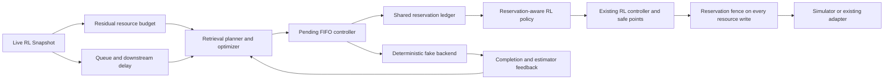

# Experimental adaptive retrieval

This optional subsystem compares retrieval planning and scheduling assumptions on
the same clock as AgentScale's four-stage RL simulator. **Every retrieval strategy
is emulated by `fake-v1`.** There is no corpus, lexical index, embedding model,
reranker model, LLM answer generation, GPU execution or external service involved.
BM25/vector/hybrid/hybrid-rerank name plan templates, not implemented search engines.
The existing simulator, runtime adapters and CLI defaults remain available.

## Run offline

```bash
python -m pip install -e '.[dev]'
agentscale retrieval-plan --query 'find supporting evidence' --dry-run
agentscale retrieval-plan --query 'semantic evidence' --lexicality 0.1 --min-quality 0.8
agentscale retrieval-simulate --duration 30 --scenario pressure --trace --output retrieval.json
agentscale retrieval-simulate --duration 30 --rl-policy global --trace --output coupled.json
agentscale retrieval-benchmark --duration 30 --seeds 42 43 44 --output retrieval-benchmark.json
pytest -q tests/test_retrieval*.py
```

`retrieval-plan` is always a dry run. Its budget is the retrieval budget alone, not
the whole RL cluster. An infeasible plan prints the rejected alternatives and exits
with status 2. `--allow-gpu --gpus 1` includes hypothetical GPU reranking candidates;
it does not allocate a device. All default candidates can run in a CPU-only simulation.
The three new commands do not change simulate/plan/benchmark or runtime command schemas.

## Planning interfaces

`agentscale/retrieval/models.py` defines validated queries, plans, resource demands,
constraints, queue state, estimates and results. Whole CPU cores, GiB, whole GPUs,
seconds, probabilities and arbitrary accounting units are distinct quantities.
Query difficulty and lexicality are explicit synthetic features, not learned classifiers.

`RetrievalBackend.retrieve(Query, RetrievalPlan) -> RetrievalResult` separates execution
from planning. `FakeRetrievalBackend` uses SHA-256 with seed, query features and plan;
results are reproducible across processes and Python hash seeds. It returns synthetic
document IDs, descending placeholder scores, a modeled duration, synthetic quality and
a sampled synthetic success flag. None are measured relevance or real task outcomes.

The planner enumerates 12 candidates: four strategies and top-K 5/10/20. Reranking
uses 40 candidates. Opt-in GPU variants add three candidates, for a bound of 15.

| Template | Peak cores | Peak GiB | GPUs |
| --- | ---: | ---: | ---: |
| BM25 | 1 | 1 | 0 |
| Vector | 1 | 2 | 0 |
| Hybrid | 2 | 3 | 0 |
| Hybrid-rerank, CPU | 4 | 4 | 0 |
| Hybrid-rerank, hypothetical GPU | 2 | 4 | 1 |

These fixed resource shapes are assumptions, independent of actual index size.
`QualityEstimator`, `LatencyEstimator` and `CostEstimator` are separate protocols.
The initial implementations use transparent synthetic priors:

- Quality depends on strategy, difficulty, lexicality, top-K and rerank depth.
  Estimated task success is quality multiplied by `(1 - 0.15 * difficulty)`.
- Service time depends on strategy, difficulty, top-K, rerank depth and the modeled
  device. Queue delay is a fluid approximation of outstanding core-seconds/cores
  and GPU-seconds/GPUs. Task latency adds elapsed pending time and downstream RL
  inference/sandbox queue delay. This is not a tail-latency guarantee.
- Cost includes search calls, retrieved/reranked candidates, reserved core/GPU time
  and a downstream context estimate of `128 + 64 * top_k` input tokens. Coefficients
  are arbitrary units, not provider prices. No real tokens or inference are executed.
- Completed fake results update quality residuals and service multipliers with
  bounded EWMA feedback (alpha 0.25). Feedback is unavailable before completion.
  Synthetic calibration rejects real-backend results so provenance cannot silently mix.

The constrained optimizer rejects resource overcommit, predicted quality/success below
the request minimum, predicted task latency above its deadline and predicted cost
above its budget. It maximizes `0.25 * quality + success - 0.08 * latency - 0.1 * cost`
over feasible candidates, with stable tie breaking. Weights are configurable and
are saved in benchmark output. No candidate means explicit rejection or queue deferral;
there is no fallback that silently relaxes a hard constraint.

Hard constraints apply to predictions at admission. Fake service jitter and quality
jitter can still produce deadline, quality or cost misses; completions and metrics
report those misses. An estimated success floor is not a guarantee of a sampled outcome.

## Shared resource integration



`residual_capacity(Snapshot)` subtracts the current inference/training GPUs and
sandbox CPU/memory reservations. It does not count training GPUs as available for
reranking. `ReservationLedger` admits a request only if its peak resource demand
plus existing retrieval reservations fits that residual capacity. Release and repeat
reservation are idempotent; conflicting tokens fail explicitly.

`ReservationAwarePolicy` implements the existing `SchedulingPolicy` protocol. It
passes reduced capacity to the chosen RL policy, then validates its answer. It does
not replace StaticPolicy, IndependentAutoscalePolicy or BottleneckAwarePolicy.

**Both proposal checks and a write fence are required.** RL rollback/compensation
can restore an older, larger allocation. `ReservationAwareAdapter` fences every apply
and raises the existing `SafePointUnavailable` signal until retrieval work drains.
For changing runtime workload shapes, update the wrapper's capacity/workload together
with fresh telemetry in the same driver. Runtime capability checks and draining remain
owned by the underlying adapter; logical GPU reservations do not provide GPU actuation.

The simulator adds two optional hooks, both disabled by default:

- `on_snapshot` runs before RL control, so retrieval observes live four-stage queues.
- `transition_guard` checks every allocation write, including rollback.

The combined runner in `retrieval/benchmark.py` shares one ledger between the
retrieval controller, RL policy wrapper and simulator transition guard. RL arrivals,
inference, sandbox work and training continue in the existing event loop. The two
task populations are independent: retrieval quality does not become RL reward or
training data, and there is no fabricated RAG-to-trajectory success relationship.

With no retrieval reservations, wrapped policies and entire seeded simulations match
the original behavior in regression tests. Existing CLI calls pass neither hook.

## Closed-loop behavior and limitations

The retrieval controller uses simulated time, a bounded FIFO pending queue, monotonic
timestamps, telemetry age validation, plan confirmation, pending-plan cooldown and a
minimum benefit margin. It defers admission during temporary queue pressure, expires
deadlines and rejects permanently infeasible requests with reasons. Admission history
includes predicted quality, success, latency, cost and resource demand.

Only pending requests can change plans. An admitted plan/result/finish event is fixed;
it completes before its reservation is released. Ordinary backend errors and invalid
results release reservations without stranding resources. A foreign reservation token
cannot be reused or released by the controller. Dry-run never calls a backend or
changes the ledger. Completion feedback cannot change an in-flight request.

The ledger and controllers are in-memory, single-driver simulation components. They
provide no distributed locking, durable recovery, real-time fairness or guaranteed
retrieval capacity. RL keeps its current allocation; new retrieval requests can be
rejected when it owns the whole modeled budget. External actors bypassing the policy
wrapper/fence can violate reservations; the retrieval controller then blocks new
admissions and allows existing work to finish. Model accounting omits inference CPU,
training CPU, index/cache storage, network and other resources absent from RL Capacity.

A real backend needs an asynchronous executor, capability checks, measured resource
profiles, trustworthy telemetry and explicit calibration/provenance rules. The current
controller intentionally accepts only matching fake-v1 results. Real BM25/vector search,
relevance labels, Recall@K/nDCG, answer correctness and real agent task success remain
future phases. See [benchmark definitions and results](retrieval-benchmarks.md) and
[the preimplementation audit](retrieval-audit.md).
